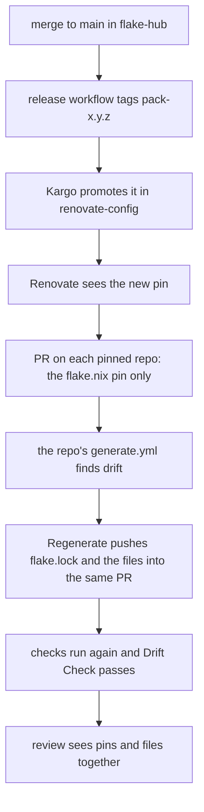

# Propagation

How a change here reaches the repos that use it.

## Tags

Every pack is tagged `<pack>-<semver>` on this one repo — `golden-base-0.1.0`,
`golden-service-0.2.0`. The tags share a namespace, so the preset in
[renovate-config](https://github.com/Fomiller/renovate-config) matches versions
per pack. A pattern that matched `.*` would offer
`golden-infra` versions for a `golden-base` pin.

## The VERSION check

Each pack directory holds a `VERSION` file. A PR that changes a pack directory
without changing its `VERSION` fails `version-bump-check.yaml`. That is what
keeps a released tag from ever meaning two different trees.

## Pack pins

A new tag does not reach repos on its own. Renovate reads pack versions from
`renovate-config`, and those pins move only after a Kargo promotion there.

## Why generation runs in the consumer

Renovate changes only the pin in `flake.nix`. It does not touch `flake.lock` or
any generated file. Teaching it to regenerate would mean giving it the whole
engine.

Instead the consumer's `generate.yml` runs on every push and PR. Its Drift
Check job relocks, regenerates, and fails if anything changed. When it fails,
the Regenerate job pushes the fix to the same branch.

Regenerate pushes with a token from the `fomiller-renovate-bot` App, not
`GITHUB_TOKEN`. A `GITHUB_TOKEN` push starts no workflows, so checks would never
run on the fixed commit. An App token push does start them. Drift Check then
reruns, finds nothing to change, and passes. Because it pushes nothing, the loop
ends there.
